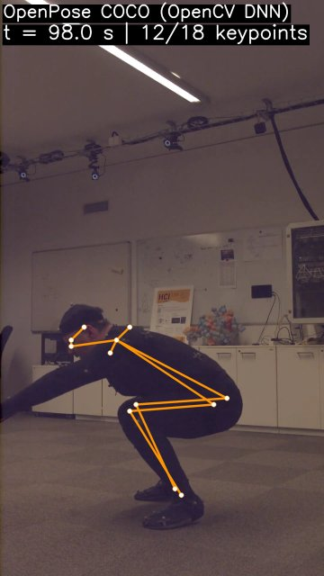
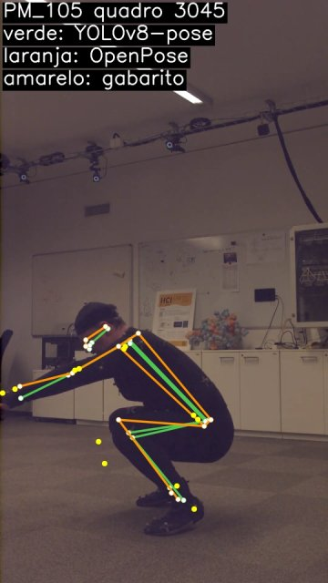
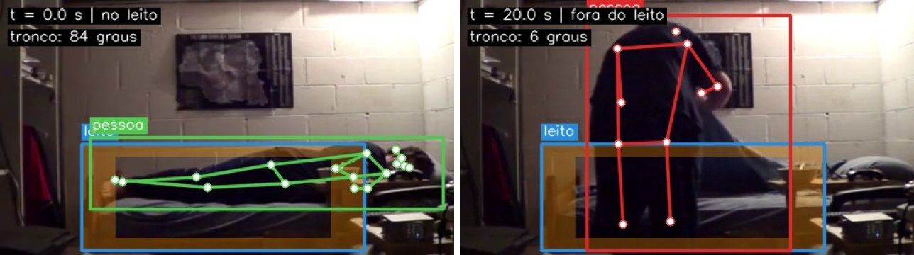
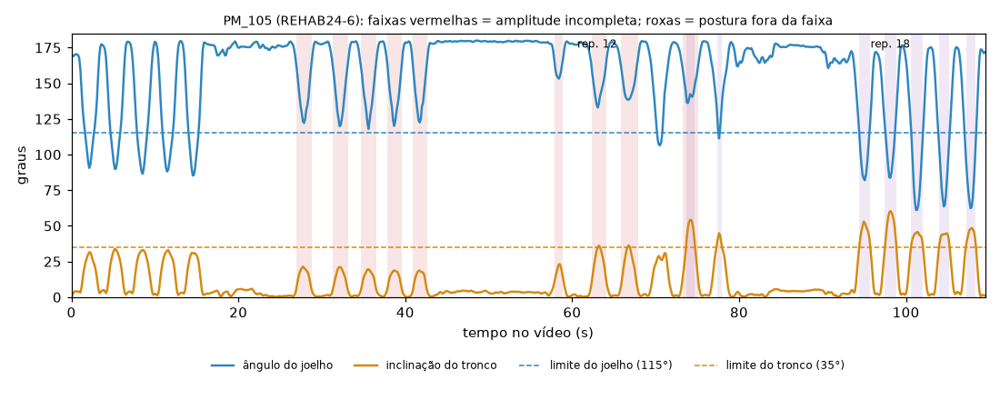
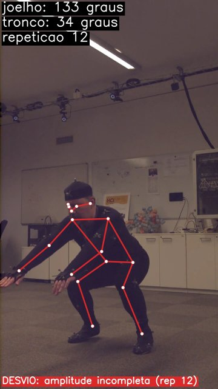
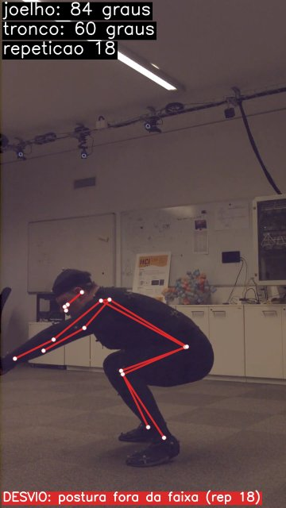

# Tech Challenge Fase 4: monitoramento multimodal de pacientes

Protótipo de demonstração técnica (pós IADT, FIAP), feito por um grupo de quatro
integrantes. Fusão tardia: cada modalidade (vídeo, áudio, texto clínico, sinais
vitais, prescrições, movimentação) é processada separadamente e convertida em
evidências estruturadas (Findings), combinadas por paciente e proximidade
temporal. **O sistema sinaliza risco e apoia a equipe; a decisão é clínica.**

O paciente sintético P001 tem dados que vêm de fontes distintas, associadas só
para a demonstração técnica.

> **Estado atual (12/11/2026):**
> - **M1:** cumprido com mocks fictícios, exceto a decisão sobre a fonte das prescrições (Integrante 3).
> - **Vídeo (Integrante 1):** módulo implementado e rodando com vídeos reais de datasets públicos: REHAB24-6 na fisioterapia e Charades no leito. O grupo decidiu não gravar vídeos próprios.
> - **Peças provisórias:** contrato, `patients.yaml`, Streamlit e fusão foram feitos pelo Integrante 1 para destravar o trabalho; o dono é o Integrante 4.
> - **Áudio/texto (Integrante 2):** módulo implementado em Python 3.13 e validado com Azure real, seis consultas sintéticas, baseline do mesmo locutor e revisão humana.
> - **Anomalias (Integrante 3):** existem só como mocks.
>
> Detalhes em [Status por integrante](#3-status-por-integrante).

## Sumário

1. [Introdução e problema (Integrante 4)](#1-introdução-e-problema-integrante-4)
2. [Responsabilidades](#2-responsabilidades)
3. [Status por integrante](#3-status-por-integrante)
4. [Estrutura do repositório](#4-estrutura-do-repositório)
5. [Instalação](#5-instalação)
6. [Arquitetura e fluxo multimodal (Integrante 4)](#6-arquitetura-e-fluxo-multimodal-integrante-4)
7. [Análise de vídeo (Integrante 1)](#7-análise-de-vídeo-integrante-1)
8. [Análise de áudio e texto clínico (Integrante 2)](#8-análise-de-áudio-e-texto-clínico-integrante-2)
9. [Detecção de anomalias (Integrante 3)](#9-detecção-de-anomalias-integrante-3)
10. [Resultados integrados, limitações e ética (Integrante 4, com todos)](#10-resultados-integrados-limitações-e-ética-integrante-4-com-todos)
11. [Testes](#11-testes)
12. [Linguagem obrigatória](#12-linguagem-obrigatória)
13. [Dados, licenças e privacidade](#13-dados-licenças-e-privacidade)
14. [Referências](#14-referências)

## 1. Introdução e problema (Integrante 4)

> **A completar pelo Integrante 4.** Conteúdo mínimo previsto no plano: contexto
> do hospital, objetivos e escopo. O texto abaixo é um ponto de partida, tirado
> do enunciado e do plano.

**Contexto.** Com a IA já integrada aos processos médicos da instituição
(exames, documentos, apoio a decisões clínicas), o hospital quer monitorar
continuamente os pacientes por meio de dados multimodais (áudio, vídeo e texto)
para identificar sinais precoces de risco.

**Objetivos do enunciado.**
- Analisar e combinar diferentes tipos de dados médicos (texto, áudio, vídeo).
- Usar serviços em nuvem para ampliar a capacidade de processamento.
- Aplicar detecção de anomalias em tempo quase real para monitoramento preventivo.

**Escopo deste protótipo.** O MVP do plano v5:
- vídeo de fisioterapia e de leito;
- áudio de consultas e notas de evolução clínica no Azure;
- anomalias em sinais vitais, prescrições e movimentação;
- fusão tardia por paciente e alerta à equipe médica (dashboard, `alerts.jsonl` e e-mail no alerta crítico).

Tudo é demonstrado com o paciente sintético P001 (seção 10). Os itens da linha
"Extra" do plano ficam fora do escopo.

## 2. Responsabilidades

Fonte: plano do grupo, *Tech Challenge Fase 4 — Divisão do trabalho v5*.

| Integrante | Frente principal | Também responde por | Pasta | Documentação técnica |
|---|---|---|---|---|
| Integrante 1 | Análise de vídeo: pose, YOLOv8, OpenPose | `movement.parquet` para o Integrante 3; frames e clipes para o dashboard | `modules/video/` | Seção 7 |
| Integrante 2 | Áudio e texto clínico (Azure Speech + Azure AI Language) | Recursos Azure, chaves e cache das respostas | `modules/audio/` | Seção 8 |
| Integrante 3 | Detecção de anomalias (vitais, prescrições, movimentação) | Simulador de vitais, prescrições e movimentação em fluxo | `modules/anomaly/` | Seção 9 |
| Integrante 4 | Integração: contrato, aplicação, fusão, alertas, dashboard | Repositório, README, arquitetura, relatório consolidado, edição do vídeo | `contracts/`, `app/` | Seções 1, 6 e 10; PDF consolidado |

O plano previa o relatório técnico em capítulos separados em `docs/` (01 a 06).
Aqui cada capítulo é uma seção deste README, e o PDF consolidado da entrega
é gerado a partir dele:

| Capítulo do plano | Seção |
|---|---|
| 01 Introdução e problema | 1 |
| 02 Arquitetura e fluxo multimodal | 6 |
| 03 Análise de vídeo | 7 |
| 04 Análise de áudio e texto | 8 |
| 05 Detecção de anomalias | 9 |
| 06 Resultados integrados, limitações e ética | 10 |

Regras que valem para todos:
- **Uma origem por evento.** `source: video` cobre só os desvios da
  fisioterapia (Integrante 1). `source: movement` cobre saída do leito e
  imobilidade (Integrante 3). `source: text` cobre as notas de evolução
  (Integrante 2).
- **Finding × alerta.** Os Integrantes 1, 2 e 3 produzem Findings; só o
  Integrante 4 emite alertas, depois da fusão.
- **Mudança no schema** só com PR marcando os outros três integrantes.
- **Linha "Extra"** do plano só depois do M3.

**Decisão do grupo (10/11/2026).** O plano previa vídeos gravados pela equipe.
O grupo decidiu não gravar e usar vídeos prontos de datasets públicos:
- **Fisioterapia:** REHAB24-6;
- **Leito:** Charades, porque o REHAB24-6 não tem leito.

Detalhes na seção 7.2.

## 3. Status por integrante

Legenda: ✅ feito · 🟡 provisório ou parcial · ⬜ pendente

### Critérios do M1 (pipeline roda com mocks)

| Critério | Status |
|---|---|
| O Streamlit inicia | ✅ |
| `patients.yaml` carrega com os `demo_offset` | ✅ |
| Todos os mocks passam na validação Pydantic | ✅ (`tests/test_mocks_schema.py`) |
| Um Finding de cada origem, incluindo `text`, aparece na linha do tempo | ✅ (`tests/test_app_smoke.py`) |
| A fonte das prescrições está decidida | ⬜ (Integrante 3) |

### Integrante 1: vídeo

| Item | Status |
|---|---|
| Mock: `movement.parquet` e `findings.jsonl` com 2 eventos | ✅ (substituído pelas saídas reais do P001) |
| Vídeos de datasets públicos no lugar de gravações: download reproduzível | ✅ (`data/download_rehab24.py`, `data/download_charades.py`) |
| Pose com YOLOv8-pose, ângulos e amplitude por repetição | ✅ (REHAB24-6: 122 de 128 repetições de agachamento encontradas) |
| Regras dos 2 eventos com limiares em `config/video.yaml` | ✅ limiares de perfil calibrados no REHAB24-6 (seção 7.6): F1 de perfil de 0,22 para 0,55 |
| OpenPose via OpenCV DNN com frames anotados (obrigatório) | ✅ (20 quadros no vídeo de fisioterapia do P001) |
| YOLOv8 pessoa + leito, zona da borda, `movement.parquet` com `in_bed` | ✅ (Charades SSP8C: leito detectado; saída do leito aos 18 s) |
| `demo_offset` nos Findings e no parquet; P001 apontando para os vídeos reais | ✅ |
| Relatório automático HTML e clipes dos desvios | ✅ |
| Métricas (P/R/F1, FPS) e avaliação contra as anotações dos datasets | ✅ (`notebooks/rehab24/`, `notebooks/charades/`) |
| Rótulos de saída do leito para o Integrante 3 | ✅ `data/labels/SSP8C.yaml`, a partir da anotação do Charades → `bed_exit_labels.json` |
| Documentação técnica (seção 7) | ✅ |
| Decidir com o grupo: amplitude relativa à própria pessoa e evento de flexão excessiva (seção 7.14) | ⬜ |
| Desejável (Integrante 1): comparação OpenPose × YOLOv8-pose | ✅ com o gabarito da captura de movimento do REHAB24-6 (seção 7.7) |
| Exemplos de anomalias detectadas no relatório (enunciado: "exemplos de anomalias detectadas") | ✅ figuras em `docs/img/video/` (seções 7.7, 7.8 e 7.12) |
| Pacote de clipes e quadros anotados para a edição do vídeo (Integrante 4) | ✅ `python -m scripts.material_video --pacote` → `outputs/pacote_video/` (seção 7.12) |
| Trecho do vídeo de entrega, bloco 1:00–3:30 do roteiro | ⬜ gravação de tela pelo Integrante 1 |
| Entregar o pacote do vídeo ao Integrante 4 | ⬜ o pacote não vai para o Git: enviar a cópia gerada ou combinar que o Integrante 4 gere a dele (seção 7.12) |
| Confirmar com o Integrante 3 as unidades do `movement.parquet` e o comportamento quando a pessoa não é detectada | ⬜ proposta na seção 7.8 |
| M4: cópia de segurança dos arquivos da demo (vídeos, gabarito, `outputs/video/P001/`) | ⬜ |
| M5: revisar a seção 7 no relatório consolidado e testar o README num ambiente limpo | ⬜ |

### Integrante 2: áudio e texto clínico

| Item | Status |
|---|---|
| Mock: `transcript.json`, Findings de áudio e de texto | ✅ (provisório, feito pelo Integrante 1) |
| Recursos Azure Speech e AI Language, credenciais por canal privado, seção de ambiente no README | ✅ recursos F0 configurados e execução real validada |
| Gravar 6–8 consultas simuladas (normal, cansado, fala arrastada, ofegante) | ✅ seis consultas e um baseline neutro do mesmo locutor |
| Transcrição Azure Speech to Text (pt-BR) com timestamps | ✅ executada no Azure real e revisada por uma pessoa |
| Sentimento e termos críticos (Azure AI Language + regex) | ✅ executados no Azure real nas consultas e nas notas sintéticas |
| Notas de evolução sintéticas do P001 em `data/notes/`, Findings `source: text`, `notes.json` | ✅ duas notas e comparação temporal implementadas |
| Indicador experimental de alteração vocal (taxa de fala, pausas, pitch, jitter, shimmer; z-score contra a linha de base do próprio paciente) | ✅ avaliado nas seis consultas sintéticas; sem validade clínica |
| Cache das respostas Azure em `outputs/audio/cache/` | ✅ cache por conteúdo e parâmetros, sem persistir chaves |
| `analyze()` e CLI em `modules/audio/` | ✅ arquivo individual e cenário P001, com mock explícito |
| Métricas (WER, acerto dos termos, concordância do indicador) e seção 8 deste README | ✅ medidas em amostra sintética revisada, com limitações declaradas |
| Desejável (Integrante 2): Text Analytics for Health | ⬜ |

### Integrante 3: anomalias e simulador

| Item | Status |
|---|---|
| Mock: dessaturação, dose duplicada, saída do leito | ✅ (provisório, feito pelo Integrante 1) |
| Baixar MIMIC-IV Demo e/ou BIDMC (PhysioNet) e decidir a fonte das prescrições | ⬜ (critério do M1) |
| Simulador em fluxo (`config/simulator.yaml`) | ⬜ |
| Detectores com `update(ponto) -> list[Finding]`: vitais, prescrições, movimentação | ⬜ |
| Série de movimentação estendida a partir do `movement.parquet` real (Charades SSP8C) | ⬜ |
| Anomalias injetadas, métricas, `series_flagged.parquet`, gráficos e seção 9 deste README | ⬜ |
| Desejável (Integrante 3): NEWS2 | ⬜ |

### Integrante 4: integração

| Item | Status |
|---|---|
| Contrato Finding (Pydantic + fixtures, incluindo `source: text`) | 🟡 provisório (Integrante 1); falta aprovação dos quatro |
| `patients.yaml` com `demo_offset` por artefato | 🟡 provisório (Integrante 1); formato a confirmar |
| Esqueleto do repositório | 🟡 provisório (Integrante 1) |
| Streamlit com linha do tempo | 🟡 esqueleto (Integrante 1) |
| Fusão: regra crítica do P001 e `alerts.jsonl` | 🟡 mínima (Integrante 1) |
| Combinação ponderada dos scores em `config/fusion.yaml` | ⬜ |
| Três níveis com deduplicação e cooldown por paciente e tipo | 🟡 cooldown só por regra |
| E-mail SMTP no alerta crítico (obrigatório), `config/alerts.yaml`, `email_sent_at`, contingência `.eml` | ✅ `app/notify.py`, um envio por alerta (seção 6.4); falta o teste com conta real |
| Upload de vídeo, áudio e nota no Streamlit; chamada a `analyze()` dos Integrantes 1 e 2; laço com o simulador do Integrante 3 | ⬜ |
| Dashboard com frames do Integrante 1, transcrição e notas do Integrante 2, séries do Integrante 3 | 🟡 transcrição e série de movimentação |
| Teste ponta a ponta do P001 com os módulos reais | 🟡 vídeo real + mocks de áudio, texto e anomalias |
| Seções 1, 6 e 10 deste README, PDF consolidado a partir dele, vídeo, submissão | ⬜ |
| Desejáveis (Integrante 4): confirmação de leitura ("Ciente"), Azure Blob Storage, Docker Compose | ⬜ |

## 4. Estrutura do repositório

```
contracts/            schema Finding, loader do patients.yaml (Integrante 4)
  fixtures/           um Finding de exemplo por origem
modules/video/        análise de vídeo (Integrante 1): fisioterapia, leito, OpenPose, relatório, métricas
modules/audio/        áudio e texto clínico (Integrante 2) - ainda vazio
modules/anomaly/      anomalias e simulador (Integrante 3) - ainda vazio
app/                  Streamlit, fusão e alertas (Integrante 4) - versão mínima
config/               video.yaml (limiares do vídeo), fusion.yaml (regras da fusão)
data/
  patients.yaml       pacientes sintéticos e demo_offset por artefato
  download_weights.py baixa os pesos dos modelos para weights/
  download_rehab24.py baixa os vídeos de fisioterapia (REHAB24-6)
  download_charades.py baixa o vídeo do leito (Charades)
  remote_zip.py       leitura parcial de zips remotos (usada pelos downloads)
  labels/             rótulos manuais dos vídeos (modelo: video.example.yaml)
  notes/              notas de evolução sintéticas (Integrante 2) - vazio
  video/              vídeos dos datasets (fora do Git)
scripts/make_mocks.py gera os mocks fictícios do M1
scripts/material_video.py figuras do README e pacote do vídeo para o Integrante 4
notebooks/rehab24/    avaliação e calibração do vídeo no REHAB24-6 (config da abdução, scripts)
notebooks/charades/   conferência da série do leito com a anotação do Charades
notebooks/comparacao/ comparação OpenPose × YOLOv8-pose com o gabarito do REHAB24-6
docs/                 enunciado oficial (PDF) e figuras do README (img/video/)
tests/                pytest
outputs/              saídas geradas (fora do Git)
weights/              pesos dos modelos (fora do Git)
.env.example          modelo do .env (segredos)
```

## 5. Instalação

Requer Python 3.13.

```powershell
py -3.13 -m venv .venv
.\.venv\Scripts\Activate.ps1          # Linux/macOS: python3.13 -m venv .venv && source .venv/bin/activate
python -m pip install -r requirements.txt
copy .env.example .env                # Linux/macOS: cp .env.example .env
python -m data.download_weights       # pesos do vídeo (~220 MB)
python -m data.download_rehab24       # 7 vídeos de fisioterapia (~160 MB) e anotações
python -m data.download_charades      # vídeo do leito (~1 MB) e anotações
```

Os downloads de vídeo leem só os arquivos escolhidos dentro dos zips dos
datasets (2,5 GB e 16 GB), sem baixar o resto. O `requirements.txt` fixa o
OpenCV 4.x de propósito: a série 5 removeu o importador Caffe usado pelo
OpenPose.

### Variáveis de ambiente

| Variável | Onde | Uso |
|---|---|---|
| `AZURE_SPEECH_KEY`, `AZURE_SPEECH_REGION` | `.env` | Azure Speech to Text (Integrante 2) |
| `AZURE_LANGUAGE_KEY`, `AZURE_LANGUAGE_ENDPOINT` | `.env` | Azure AI Language (Integrante 2) |
| `SMTP_HOST`, `SMTP_PORT`, `SMTP_USER`, `SMTP_PASSWORD`, `ALERT_EMAIL_FROM`, `ALERT_EMAIL_TO` | `.env` | e-mail do alerta crítico (Integrante 4); `ALERT_EMAIL_TO` aceita vários destinatários separados por vírgula |
| `TC_OUTPUTS_DIR` | opcional | troca a pasta `outputs/` (usado nos testes) |
| `TC_PATIENTS_PATH` | opcional | troca o `data/patients.yaml` (usado nos testes) |

Os nomes das variáveis do `.env` são provisórios: os Integrantes 2 e 4 definem
os finais.

### GPU (opcional)

O `requirements.txt` instala o PyTorch de CPU, que roda em qualquer máquina.
Todos os tempos deste README foram medidos em CPU. Com GPU NVIDIA, troque pelo
build CUDA (confira em pytorch.org o índice certo para a sua versão de CUDA;
este comando não foi testado):

```powershell
python -m pip install --force-reinstall torch==2.15.0 torchvision==0.29.2 --index-url https://download.pytorch.org/whl/cu128
```

## 6. Arquitetura e fluxo multimodal (Integrante 4)

### 6.1 Visão geral do fluxo

Fusão tardia: cada modalidade é processada separadamente e convertida em
evidências estruturadas, combinadas por paciente e proximidade temporal.

```
Vídeos (REHAB24-6, Charades) ──► Integrante 1 · Vídeo ──────── Findings ──┐
                                  pose, YOLOv8, OpenPose                   │
                                        │ movement.parquet                 │
                                        ▼                                  ▼
PhysioNet (vitais, prescrições) ──► Integrante 3 · Anomalias ── Findings ──► Integrante 4 · Integração ──► Equipe médica
                                  detectores + simulador                   ▲   contrato, fusão tardia,     dashboard,
                                                                           │   alertas, dashboard          alerts.jsonl,
Áudios e notas de evolução ─────► Integrante 2 · Áudio e texto ─ Findings ─┘                               e-mail (crítico)
                                  Azure Speech e Language
```

- Todas as evidências convergem no Integrante 4.
- A única dependência direta entre módulos é o `movement.parquet` do Integrante 1 para o Integrante 3.
- O alinhamento temporal de todas as fontes usa o `demo_offset` do `patients.yaml` (seção 6.2).

> **A completar pelo Integrante 4:** diagrama final da arquitetura para o
> relatório técnico.

### 6.2 Contrato comum

#### Finding (`contracts/finding.py`)

Toda saída de módulo que vira alerta é um `findings.jsonl` (um Finding por
linha). Exemplo real do vídeo de fisioterapia do P001 (a pose vem do YOLOv8n-pose):

```json
{"finding_id": "71594ce1-2a63-4344-872e-59e6be9604c6", "patient_id": "P001", "source": "video",
 "type": "amplitude_incompleta",
 "timestamp_start": "2026-11-03T10:01:02.333333-03:00", "timestamp_end": "2026-11-03T10:01:04.133333-03:00",
 "score": 0.294, "severity": "medium",
 "description": "Amplitude incompleta na repetição 12 (agachamento): ângulo do joelho chegou a 133°, esperado até 115°",
 "evidence": {"metric": "knee_angle", "value": 132.6, "expected": [70.0, 115.0], "deviation": 17.6,
              "rep": 12, "side": "left", "video": "data/video/rehab24-6/PM_105-Camera18-30fps-transposed.mp4",
              "media_start_s": 62.333, "media_end_s": 64.133},
 "model": {"name": "yolov8n-pose", "version": "8.4.208"},
 "artifacts": ["outputs/video/P001/clip_PM_105-Camera18-30fps-transposed_07.mp4",
               "outputs/video/P001/frames/PM_105-Camera18-30fps-transposed/desvio_07_amplitude_incompleta.jpg"]}
```

- `source`: `video | audio | text | vitals | prescription | movement`.
- `severity`: `low | medium | high | critical`, derivada por limiares declarados em `config/<modulo>.yaml`.
- `score` normalizado em 0–1.
- Horários ISO 8601 com fuso `-03:00`; `timestamp_end` não pode ser anterior ao início.
- Campos extras são rejeitados; o que for específico de um módulo vai em `evidence`.

Funções úteis: `read_findings(path)`, `write_findings(path, findings)`.

#### `type` usados até agora (a confirmar pelo grupo)

| `source` | `type` | Quem emite |
|---|---|---|
| `video` | `amplitude_incompleta`, `postura_fora_padrao` | Integrante 1 |
| `audio` | `termo_critico`, `indicador_vocal_alterado` | Integrante 2 |
| `text` | `termo_critico` | Integrante 2 |
| `vitals` | `dessaturacao` | Integrante 3 |
| `prescription` | `dose_duplicada` | Integrante 3 |
| `movement` | `saida_do_leito` | Integrante 3 |

Para termos críticos, a fusão lê o termo em `evidence.term`.

#### `data/patients.yaml` (formato provisório)

```yaml
demo_reference: "2026-11-03T10:00:00-03:00"
patients:
  P001:
    description: ...
    artifacts:
      video_fisio: {kind: video_physio, path: data/video/rehab24-6/PM_105-Camera18-30fps-transposed.mp4, demo_offset: 0}
      video_leito: {kind: video_bed,    path: data/video/charades/SSP8C.mp4, demo_offset: 600}
      consulta:    {kind: audio,        path: data/audio/P001_consulta.wav, demo_offset: 1800}
```

- `kind`: `video_physio | video_bed | audio | note | vitals | prescriptions`.
- `path` relativo à raiz; `null` enquanto não definido.
- `demo_offset` em segundos (pode ser negativo).
- Cada módulo grava `instante = demo_reference + demo_offset + tempo interno da mídia`
  (`PatientsFile.demo_time()`).

O P001 tem hoje:
- fisioterapia (0 s) e leito (600 s), com vídeos reais;
- consulta (1800 s), nota anterior (−86400 s) e nota recente (2400 s), ainda sem arquivo;
- vitais e prescrições (0 s, `path: null`).

#### Interface dos módulos

```python
analyze(input, patient_id) -> list[Finding]
```
```
python -m modules.<modulo>.run --input ... --patient P001 --out findings.jsonl
```

### 6.3 Mocks (M1)

Os mocks deixam o pipeline rodar de ponta a ponta antes dos módulos reais. São
**todos fictícios** e gerados por um único script:

```powershell
python -m scripts.make_mocks              # gera tudo em outputs/
python -m scripts.make_mocks --skip i1    # preserva as saídas reais de vídeo (use depois de rodar o módulo de vídeo)
```

`--skip` aceita `i1`, `i2` e `i3` (Integrantes 1, 2 e 3).

#### Como um mock é marcado

- **Findings:** `description` começa com `[MOCK]`, `model.name` começa com
  `mock-` (`mock-i1`, `mock-i2`, `mock-i3`) e `evidence.mock = true`.
- **`movement.parquet`:** metadado de arquivo `mock=true`; as colunas seguem o
  plano sem alteração. A série real grava `mock=false`.
- **`transcript.json`:** campo `"mock": true`.
- **Streamlit:** mostra um aviso sempre que há Finding fictício na tela.

A saída é determinística: mesmos IDs e valores a cada execução.

#### Linha do tempo do P001

Referência `2026-11-03T10:00-03:00`, com os `demo_offset` do `patients.yaml`.
Mapeia os passos do cenário P001 do plano.

| Horário | Origem | Evento | Severidade (score) | Fonte hoje | Passo do cenário |
|---|---|---|---|---|---|
| 10:00:26–10:01:48 | `video` | 9 `amplitude_incompleta` e 7 `postura_fora_padrao` (seção 7.12) | low a high | **real** (REHAB24-6 PM_105) | 1 |
| 10:10:18–10:10:24 | `movement` | `saida_do_leito` | medium (0,70) | mock do Integrante 3, alinhado à série real do leito | 2 |
| 10:20:00 | `prescription` | `dose_duplicada` (dipirona 1000 mg, 2×) | medium (0,70) | mock | 5 |
| 10:30:30–10:31:30 | `audio` | `indicador_vocal_alterado` (z-scores em `evidence.zscores`) | medium (0,68) | mock | 3 |
| 10:31:15–10:31:19 | `audio` | `termo_critico` "falta de ar" | medium (0,80) | mock | 3 |
| 10:40:00 | `text` | `termo_critico` "dispneia aos esforços" (ausente na nota anterior) | medium (0,75) | mock | 4 |
| 10:45:00–10:48:00 | `vitals` | `dessaturacao` (SpO2 87%, esperado 94–100%) | high (0,90) | mock | 5 |

Os Findings da regra crítica (indicador vocal, termo respiratório e queda de
SpO2) ficam entre 10:30 e 10:45, dentro da janela de 30 min. A fusão emite o
alerta crítico às 10:48.

#### Arquivos de cada mock

**Integrante 1: `outputs/video/P001/`** (hoje substituídos pelas saídas reais)
- `findings.jsonl`: dois eventos de fisioterapia inventados (10:00:12 e 10:00:31).
- `movement.parquet`: 150 linhas a 5 Hz, de 10:10:00 a 10:10:29,8, com as
  colunas `patient_id`, `timestamp` (com fuso -03:00), `centroid_x`,
  `centroid_y`, `torso_angle`, `velocidade` e `in_bed` (bool).
  - O paciente fica deitado e parado no leito (tronco ~86° da vertical) até 14,4 s.
  - Depois senta, levanta e caminha para fora.
  - `in_bed` vira `false` em 10:10:18,0, o mesmo instante do vídeo real do leito e do `saida_do_leito` do mock do Integrante 3.

**Integrante 2: `outputs/audio/P001/` e `outputs/text/P001/`**
- `audio/P001/findings.jsonl`: `termo_critico` ("falta de ar", com o trecho em
  `evidence.segment_text`) e `indicador_vocal_alterado` (linha de base nos
  primeiros 30 s; z-scores de taxa de fala, pausas, pitch, jitter e shimmer).
- `audio/P001/transcript.json`, escrito à mão. Formato provisório (o Integrante 2 define o final):
  ```json
  {"mock": true, "aviso": "...", "patient_id": "P001", "audio": "data/audio/P001_consulta.wav",
   "language": "pt-BR",
   "segments": [{"start": 75.0, "end": 79.0,
                 "timestamp_start": "2026-11-03T10:31:15-03:00", "timestamp_end": "...",
                 "text": "Ontem à noite senti muita falta de ar ...", "sentiment": "negative",
                 "critical_terms": [{"term": "falta de ar", "offset": 26, "length": 11}]}]}
  ```
- `text/P001/findings.jsonl`: `termo_critico` "dispneia aos esforços" na nota
  recente (`evidence.note`, `evidence.ausente_na_anterior`).

**Integrante 3: `outputs/anomaly/P001/findings.jsonl`**
- `dessaturacao` (`vitals`), `dose_duplicada` (`prescription`) e
  `saida_do_leito` (`movement`).

#### Como trocar um mock pelo módulo real

1. O módulo real grava **no mesmo caminho e no mesmo formato** do mock. O
   Streamlit e a fusão leem `outputs/<video|audio|text|anomaly>/<paciente>/findings.jsonl`
   sem saber se é mock.
2. A partir daí, regenere os mocks dos outros com `--skip`. O vídeo já fez
   isso: `python -m scripts.make_mocks --skip i1`.
3. Rode `python -m pytest`. Os testes de mocks usam pasta temporária, mas o
   `read_findings()` valida qualquer saída real contra o contrato.

### 6.4 Aplicação, fusão e alertas

```powershell
streamlit run app/streamlit_app.py
```

O que a versão mínima faz:
- Carrega o `patients.yaml` e lê todos os `findings.jsonl` em `outputs/`.
- Mostra, por paciente:
  - os artefatos com os `demo_offset`;
  - os alertas;
  - a linha do tempo multimodal e a tabela de Findings;
  - a série de movimentação;
  - a transcrição, com os termos críticos destacados.
- Roda a fusão de todos os pacientes e grava `outputs/alerts.jsonl`.

Fusão (`app/fusion.py`, regras em `config/fusion.yaml`):
- **Regra crítica do plano:** indicador vocal alterado + termo respiratório
  (na consulta ou na nota) + queda de SpO2 na mesma janela de 30 min. A lista
  de termos respiratórios fica no YAML.
- **Cooldown** de 30 min por regra e paciente.
- **Findings fora de regra** viram alerta isolado pela severidade:
  `low`/`medium` → atenção, `high` → urgente, `critical` → crítico.

Com o vídeo real e os mocks dos Integrantes 2 e 3, o P001 tem hoje:
- 1 alerta crítico, às 10:48;
- 2 alertas urgentes, das repetições com severidade alta;
- 17 alertas de atenção.

Formato provisório de cada linha do `alerts.jsonl`:

```json
{"alert_id": "...", "patient_id": "P001", "level": "critico", "rule": "respiratorio_vocal_spo2",
 "description": "...", "finding_ids": ["...", "...", "..."],
 "window_start": "2026-11-03T10:30:30-03:00", "window_end": "2026-11-03T10:48:00-03:00",
 "created_at": "2026-11-03T10:48:00-03:00", "email_sent_at": null}
```

E-mail do alerta crítico (`app/notify.py`, opções em `config/alerts.yaml`):
- **Quando:** logo depois da fusão, para os níveis listados em `email.levels`
  (padrão: só `critico`).
- **Conteúdo:** nível, paciente, horário, regra e cada Finding que sustentou o
  alerta. O assunto sai com o prefixo `[DEMONSTRAÇÃO]`.
- **Um envio por alerta:** o `alert_id` é determinístico e cada entrega fica em
  `outputs/alerts_delivery.jsonl`, então recarregar a tela não reenvia.
- **Contingência:** sem SMTP no `.env`, ou se o envio falhar, a mensagem é
  gravada em `outputs/alerts/eml/<alert_id>.eml` e o dashboard mostra o motivo.
  `email_sent_at` só é preenchido quando o servidor aceitou a mensagem.
- **Depois de uma falha real** o envio não é repetido sozinho; apague a linha
  do alerta em `alerts_delivery.jsonl` para tentar de novo.
- **Segredos:** servidor, senha, remetente e destinatários vêm só do `.env`.

Ainda não implementado (Integrante 4):
- combinação ponderada dos scores;
- confirmação de leitura;
- upload e chamada a `analyze()`;
- processamento incremental (hoje o `alerts.jsonl` é reescrito a cada execução).

### 6.5 Serviços em nuvem (Azure)

> **A preencher pelos Integrantes 2 e 4.** Recursos usados, nível de preço,
> região, como as credenciais são distribuídas (canal privado, `.env`) e como o
> cache evita gastar cota (`outputs/audio/cache/`).

O que o plano já define:

| Serviço | Uso | Responsável |
|---|---|---|
| Azure Speech to Text | Transcrição das consultas em pt-BR, com timestamps | Integrante 2 |
| Azure AI Language | Sentimento por frase e termos críticos, na transcrição e nas notas de evolução | Integrante 2 |
| Text Analytics for Health (desejável) | Entidades clínicas em português | Integrante 2 |
| Azure Blob Storage (desejável) | Uploads da aplicação | Integrante 4 |

O Azure AI Anomaly Detector foi aposentado em 1º/10/2026. Por isso os
detectores do Integrante 3 rodam localmente (seção 9).

## 7. Análise de vídeo (Integrante 1)

Código em `modules/video/`, limiares em `config/video.yaml`.

### 7.1 Objetivo e escopo

O enunciado pede três coisas:
- processar vídeos clínicos;
- apontar movimentos ou eventos fora do padrão esperado, com OpenPose (análise postural) e YOLOv8 (objetos e áreas críticas);
- gerar relatórios automáticos com os desvios.

O módulo atende isso em dois cenários:

| Cenário | Para quê | O que o módulo produz |
|---|---|---|
| Sessão de fisioterapia (principal) | Apontar desvios na execução do exercício | Findings `source: video` dos tipos `amplitude_incompleta` e `postura_fora_padrao`, clipes e quadros anotados, relatório HTML |
| Paciente no leito | Alimentar a detecção de anomalias de movimentação (Integrante 3) e mostrar o YOLOv8 com área crítica | Série `movement.parquet` (~5 Hz) e quadros anotados com pessoa, leito e zona da borda. Nenhum Finding |

O cenário do leito não emite Findings. Saída do leito e imobilidade são
sinalizadas só pelo módulo de anomalias (`source: movement`), pela regra "uma
origem por evento". Detecção de queda e vídeo de cirurgia estão fora do escopo
do MVP (linha "Extra" do plano).

O módulo sinaliza desvios em relação a limiares configurados; não faz
diagnóstico.

### 7.2 Dados: vídeos de datasets públicos

O grupo não grava vídeos. Os vídeos vêm de dois datasets públicos, baixados
por script para `data/video/`, fora do Git:

| Dataset | Uso | Licença | Download |
|---|---|---|---|
| **REHAB24-6** (Černek, Sedmidubsky e Budikova, SISAP 2024) | Fisioterapia | CC BY-NC 4.0: uso não comercial, com citação | `python -m data.download_rehab24` |
| **Charades** (Sigurdsson et al., ECCV 2016; Allen Institute for AI) | Leito | Não comercial, para pesquisa acadêmica; proíbe redistribuir; em publicação, só trechos curtos ou quadros | `python -m data.download_charades` |

Os dois datasets foram gravados por voluntários que consentiram com a
publicação. O paciente sintético P001 usa um vídeo de cada.

**REHAB24-6**
- **Participantes:** 10 pessoas, cada uma com 6 exercícios.
- **Câmeras:** duas, a 30 FPS, em ângulos ortogonais.
- **Vistas:** em cada vídeo a pessoa muda de direção no meio da série, então a mesma câmera a vê em duas vistas: perfil e meio-perfil no agachamento.
- **Anotações:** um fisioterapeuta orientou execuções corretas e incorretas. O dataset anota início e fim de cada repetição e se ela foi correta, mas **não o tipo do erro**.

São usados 7 dos 136 vídeos. Para cada exercício foi escolhida a câmera que vê
o movimento no plano em que ele acontece:

| Vídeo | Exercício | Pessoa | Câmera | Duração | Repetições anotadas (incorretas) | Uso |
|---|---|---|---|---|---|---|
| PM_105 | agachamento | 6 | 18 (1080×1920) | 110 s | 21 (11) | **fisioterapia do P001** e avaliação |
| PM_022 | agachamento | 2 | 18 | 92 s | 22 (1) | avaliação |
| PM_043 | agachamento | 5 | 18 | 115 s | 20 (10) | avaliação |
| PM_113 | agachamento | 8 | 18 | 130 s | 22 (5) | avaliação |
| PM_118 | agachamento | 9 | 18 | 82 s | 23 (5) | avaliação |
| PM_126 | agachamento | 7 | 18 | 113 s | 20 (10) | avaliação |
| PM_001 | abdução do braço direito | 1 | 17 (1920×1080) | 101 s | 10 (5) | avaliação de outro exercício |

**Charades**
- **Conteúdo:** vídeos caseiros de cerca de 30 s com ações anotadas.
- **Escolha:** vídeos de quarto em que o roteiro descreve sair da cama e a anotação tem "deitado na cama" seguido de "levantando-se".
- **Vídeo usado:** o **SSP8C** (30 s, 480×270, câmera parada, cama inteira em quadro), que é o **leito do P001**.
- **Anotação do SSP8C:** deitado na cama de 0 a 11,5 s; levantando-se de 13,7 a 19,1 s.
- **Descartados:** 5 candidatos foram inspecionados e 3 processados. No MLK57 a pessoa ficou pouco visível no escuro (27% das amostras); no 580G0 o YOLOv8 não detectou o leito.

**Calibração.**
- **Agachamento:** os limiares do `config/video.yaml` foram calibrados com os 6 vídeos de agachamento, só na vista de perfil (seção 7.6).
- **Abdução (PM_001):** não foi calibrada. Usa uma configuração própria do exercício, em `notebooks/rehab24/abducao.yaml`:
- ângulo do ombro, braço direito, ângulo que aumenta;
- braço ao menos na horizontal (80°);
- tronco ereto (0–15°).

### 7.3 Como rodar

```powershell
python -m data.download_weights
python -m data.download_rehab24
python -m data.download_charades

# P001 (cenário e demo_offset vêm do patients.yaml)
python -m modules.video.run --patient P001 --input data/video/rehab24-6/PM_105-Camera18-30fps-transposed.mp4 data/video/charades/SSP8C.mp4
python -m modules.video.openpose --patient P001 --max-frames 20 --input data/video/rehab24-6/PM_105-Camera18-30fps-transposed.mp4
python -m scripts.make_mocks --skip i1   # mocks dos Integrantes 2 e 3 sem apagar o vídeo real
streamlit run app/streamlit_app.py
```

Vídeo fora do `patients.yaml`:
- **Cenário:** acrescente `--scenario physio` ou `--scenario bed`; o `demo_offset` vira 0.
- **Saídas separadas:** use `--outputs` para não misturar com o P001.
- **Vários vídeos:** podem ir no mesmo `--input`.
- **Só leito:** rodar só vídeos de leito não altera o `findings.jsonl`.

#### Como os outros integrantes geram as saídas do vídeo

Vídeos, pesos e `outputs/` não vão para o Git, e a licença do Charades proíbe
redistribuir os dados. Por isso cada integrante gera na própria máquina só o
que consome. Antes, faça `git pull` e a instalação da seção 5.

| Integrante | O que usa do vídeo | Onde fica |
|---|---|---|
| Integrante 2 | Nada do vídeo. Usa só o contrato e o `patients.yaml`, que já estão no Git | — |
| Integrante 3 | Série de movimentação do leito e rótulo de saída do leito | `outputs/video/P001/movement.parquet`, `outputs/video/P001/bed_exit_labels.json` |
| Integrante 4 | Findings do vídeo para a fusão; relatório, quadros e clipes para o dashboard; pacote para a edição do vídeo de entrega | `outputs/video/P001/`, `outputs/pacote_video/` |

**Integrante 3** (cerca de 15 MB de download, segundos de processamento):

```powershell
python -m data.download_weights --only yolo
python -m data.download_charades
python -m modules.video.run --patient P001 --input data/video/charades/SSP8C.mp4
```

O rótulo de saída do leito vem de `data/labels/SSP8C.yaml`, que já está no Git.

**Integrante 4** (cerca de 250 MB de download, uns 2 minutos de processamento em CPU):

```powershell
python -m data.download_weights
python -m data.download_rehab24 Ex6/PM_105-Camera18-30fps-transposed.mp4
python -m data.download_charades
python -m modules.video.run --patient P001 --input data/video/rehab24-6/PM_105-Camera18-30fps-transposed.mp4 data/video/charades/SSP8C.mp4
python -m modules.video.openpose --patient P001 --max-frames 20 --input data/video/rehab24-6/PM_105-Camera18-30fps-transposed.mp4
python -m scripts.make_mocks --skip i1   # sem --skip i1, os mocks apagam as saídas reais do vídeo
python -m scripts.material_video --pacote
streamlit run app/streamlit_app.py
```

- **Figura de comparação no pacote:** sem o gabarito, o pacote sai sem a figura da comparação OpenPose × YOLOv8-pose. Para incluí-la, rode antes `python -m data.download_rehab24 --gabarito` e `python -m notebooks.comparacao.openpose_yolo` (cerca de 4 minutos a mais). A figura já está no README.
- **Cópia direta:** dentro do grupo, o Integrante 1 também pode enviar a própria cópia de `outputs/video/P001/` e `outputs/pacote_video/`. A restrição do Charades é sobre publicar. Gerar pelos comandos garante que todos usem a mesma versão.
- **Ambiente limpo:** esta sequência ainda não foi testada do zero (pendência do M5 no status do Integrante 1).

Avaliação contra as anotações dos datasets (seção 7.11):

```powershell
$v = "data/video/rehab24-6"
python -m modules.video.run --patient P001 --scenario physio --outputs outputs/rehab24-6 --input "$v/PM_022-Camera18-30fps-transposed.mp4" "$v/PM_043-Camera18-30fps-transposed.mp4" "$v/PM_105-Camera18-30fps-transposed.mp4" "$v/PM_113-Camera18-30fps-transposed.mp4" "$v/PM_118-Camera18-30fps-transposed.mp4" "$v/PM_126-Camera18-30fps-transposed.mp4"
python -m modules.video.run --patient P001 --scenario physio --outputs outputs/rehab24-6 --config notebooks/rehab24/abducao.yaml --out outputs/rehab24-6/video/P001/findings_abducao.jsonl --input "$v/PM_001-Camera17-30fps.mp4"
python -m notebooks.rehab24.avaliacao   # tabelas de repetições e de sinalização
python -m notebooks.rehab24.calibracao  # calibração dos limiares de perfil (seção 7.6)
python -m notebooks.charades.leito      # série do leito do P001 × anotação do Charades

# comparação OpenPose × YOLOv8-pose (seção 7.7), ~4 min em CPU
python -m data.download_rehab24 --gabarito   # articulações 2D/3D da captura de movimento (~16 MB lidos)
python -m notebooks.comparacao.openpose_yolo

# figuras do README (docs/img/video/) e pacote para a edição do vídeo (outputs/pacote_video/)
python -m scripts.material_video
```

### 7.4 Visão geral do pipeline

```
                 data/patients.yaml (cenário + demo_offset)
                               │
vídeo .mp4 ──► leitura (OpenCV) ──┬─► Fisioterapia ─► YOLOv8-pose ─► ângulos ─► repetições ─► regras
                                  │                                                         │
                                  │                        Findings (source: video) ◄──────┤
                                  │                        clipes, quadros, report.html ◄──┘
                                  │
                                  ├─► Leito ─► YOLOv8 (pessoa, leito) + YOLOv8-pose (tronco)
                                  │                  └─► movement.parquet (~5 Hz) ─► Integrante 3
                                  │
                                  └─► OpenPose (OpenCV DNN) em N quadros ─► quadros com esqueleto
```

Interface do contrato:

```python
from modules.video import analyze
findings = analyze("data/video/rehab24-6/PM_105-Camera18-30fps-transposed.mp4", "P001")   # list[Finding]
```

### 7.5 Modelos

Os três modelos já vêm treinados e são usados sem ajuste fino. O que é
específico do projeto são as regras sobre a pose (seção 7.6).

| Modelo | Uso | Implementação | Saída |
|---|---|---|---|
| YOLOv8n-pose | Pose da fisioterapia; inclinação do tronco no leito | `ultralytics` 8.4.208 (PyTorch), treinado no COCO Keypoints | 17 keypoints COCO por pessoa, com confiança |
| YOLOv8n | Pessoa e leito no cenário do leito | `ultralytics` 8.4.208, classes COCO `person` e `bed` | Caixas com confiança |
| OpenPose COCO (`pose_iter_440000`) | Requisito do enunciado: análise postural com OpenPose | Caffe, executado pelo módulo DNN do OpenCV 4.14 | 18 keypoints (mapas de calor) |

**Pesos**
- `python -m data.download_weights` baixa todos para `weights/`, fora do Git.
- Os do YOLOv8 vêm das releases oficiais da Ultralytics.
- O servidor original da CMU com os pesos do OpenPose não responde. O script usa um espelho no Hugging Face e confere o SHA-256.

**Modelo usado nas regras: YOLOv8-pose.** Os motivos:
- roda no mesmo framework do detector de objetos;
- devolve keypoints já associados a cada pessoa;
- na comparação com gabarito da seção 7.7, foi 77 vezes mais rápido em CPU, mais estável e com menor erro médio em pixels que o OpenPose.

O OpenPose roda numa amostra de quadros, como evidência do requisito.

Velocidade medida na máquina de desenvolvimento, só com CPU:

| Medição | Resultado |
|---|---|
| YOLOv8n-pose nos vídeos do REHAB24-6 (1080×1920 e 1920×1080) | 68 a 78 quadros por segundo de inferência |
| Vídeo de fisioterapia de 82 a 130 s, analisado a 15 FPS, com vídeo anotado gravado | 48 a 76 s de processamento |
| Vídeo do leito (Charades, 30 s, 480×270) | cerca de 4 s |
| OpenPose no recorte da pessoa (PM_105) | 0,78 a 0,84 FPS |
| OpenPose no quadro inteiro (foto 1280×720) | cerca de 5 s por quadro |

### 7.6 Cenário de fisioterapia

#### Ângulos articulares

Para cada quadro analisado, a pessoa principal é a de maior área de caixa
ponderada pela confiança. Keypoints com confiança abaixo de 0,3 contam como
ausentes. A partir dos 17 keypoints são calculados, por lado:

| Articulação | Ângulo no vértice | Pontos |
|---|---|---|
| Joelho | joelho | quadril – joelho – tornozelo |
| Quadril | quadril | ombro – quadril – joelho |
| Cotovelo | cotovelo | ombro – cotovelo – punho |
| Ombro | ombro | quadril – ombro – cotovelo |

Também se calcula a **inclinação do tronco**: o ângulo, em relação à vertical,
do vetor que vai do ponto médio dos quadris ao ponto médio dos ombros (0° =
ereto, 90° = horizontal).

Tratamento das séries:
- **Taxa de análise:** 15 quadros por segundo (`physio.process_fps`).
- **Lacunas:** buracos de keypoints de até 0,5 s são interpolados linearmente; lacunas maiores ficam vazias.
- **Suavização:** média móvel centrada de 0,3 s.
- **Lado do corpo:** escolhido automaticamente pela fração de quadros com o ângulo válido mais a confiança média dos keypoints daquele lado. Pode ser fixado em `primary_angle.side`.

#### Repetições e amplitude

O ângulo principal (padrão: joelho, no agachamento) define as repetições:

1. **Repouso:** o ângulo de repouso é o percentil 90 do ângulo no vídeo (percentil 10 quando o movimento aumenta o ângulo).
2. **Início e fim:** a repetição começa quando o ângulo se afasta mais de 15° do repouso e termina quando volta para dentro dessa faixa.
3. **Filtro de ruído:** só conta repetição com amplitude de pelo menos 25° e duração de pelo menos 0,8 s.
4. **Pico:** o extremo do ângulo dentro da repetição é o pico, que define a amplitude atingida.

A direção do movimento é configurável: `direction: decrease` para flexão, como
no agachamento, e `increase` para movimentos que abrem o ângulo, como a
abdução de ombro. O mesmo código serve a outros exercícios trocando só o
`config/video.yaml`.

#### Regras de desvio

| Evento (`type`) | Quando é sinalizado | Faixa esperada (inicial) | Score | Severidade por desvio |
|---|---|---|---|---|
| `amplitude_incompleta` | O pico do ângulo principal na repetição não chega à faixa esperada | joelho até 115° (faixa 70–115°) | desvio ÷ 60°, limitado a 1 | < 15°: low · 15–35°: medium · ≥ 35°: high |
| `postura_fora_padrao` | A inclinação do tronco fica fora da faixa esperada por pelo menos 0,5 s seguidos dentro da repetição | 0–35° | desvio ÷ 40°, limitado a 1 | < 10°: low · 10–25°: medium · ≥ 25°: high |

- **Desvio:** a distância, em graus, entre o valor medido e o limite da faixa. O score fica normalizado em 0–1, como pede o contrato.
- **Unidade de avaliação:** as duas regras são avaliadas por repetição, e cada desvio vira um Finding com o número da repetição.
- **Postura fora das repetições:** não é avaliada.
- **Limiares:** calibrados para agachamento de perfil no REHAB24-6 (abaixo). Antes da calibração eram 100° e 45°.

#### Calibração dos limiares de perfil

Script: `notebooks/rehab24/calibracao.py`. Saídas em `outputs/calibracao/`.

**Para que serve.** Os limiares iniciais (joelho até 100°, tronco até 45°)
tinham sido escolhidos sem dados. No REHAB24-6, agachamentos corretos de
perfil chegavam a 111° e eram sinalizados. Calibrar é escolher os limites a
partir de vídeos anotados, de forma reproduzível, para que o relatório possa
justificar cada um.

**Método**
- **Vista:** só repetições de perfil (61 repetições, 20 incorretas), que é a vista da demo.
- **Medidas por repetição anotada:** o pico do joelho e a maior inclinação do tronco mantida por 0,5 s.
- **Separação por pessoa:** calibração em PM_022, PM_043 e PM_126; teste em PM_105, PM_113 e PM_118, que a busca não vê.
- **Busca em grade:** maximiza o F1 de "repetição incorreta".
- **Estabilidade:** a busca foi repetida 6 vezes, deixando uma pessoa de fora a cada vez.

**O que a busca mostrou**
- **Amplitude:** em todas as rodadas, a busca prefere **desligar** a regra. Nos agachamentos de perfil do REHAB24-6, as repetições incorretas descem **mais** que as corretas (pico de 60–105° contra 72–111°), então não há exemplos de amplitude incompleta para calibrar.
- **Postura:** o limite escolhido variou entre 20° e 35° conforme a pessoa deixada de fora (35° em 3 das 6 rodadas). Com 10 repetições incorretas por conjunto, o ótimo é instável.

**Limiares adotados**
- **Joelho até 115°:** logo acima do maior pico de um agachamento **correto** de perfil nos 6 vídeos (111°). A regra, exigida pelo plano, continua sinalizando amplitude claramente incompleta sem gerar falsos positivos de perfil.
- **Tronco até 35°:** o valor mais escolhido e o mais conservador entre os escolhidos.

| Repetições de perfil | Limiares | VP | FP | FN | VN | Precisão | Recall | F1 |
|---|---|---|---|---|---|---|---|---|
| teste (3 pessoas) | antes (100°, 45°) | 3 | 9 | 7 | 12 | 0,25 | 0,30 | 0,27 |
| teste (3 pessoas) | calibrados (115°, 35°) | 9 | 7 | 1 | 14 | 0,56 | 0,90 | 0,69 |
| todas (6 pessoas) | antes (100°, 45°) | 4 | 12 | 16 | 29 | 0,25 | 0,20 | 0,22 |
| todas (6 pessoas) | calibrados (115°, 35°) | 12 | 11 | 8 | 30 | 0,52 | 0,60 | 0,56 |

**Ressalvas**
- **Números otimistas:** os valores adotados foram decididos olhando os 6 vídeos, pela validação deixando uma pessoa de fora.
- **Origem do ganho:** vem da regra de postura. A de amplitude não tem, nestes dados, erros do tipo que ela procura.
- **Vista:** os limiares valem para perfil. Em meio-perfil a sinalização piorou (seção 7.11).

O exemplo de Finding da seção 6.2 é real: repetição 12 do PM_105.

### 7.7 OpenPose (requisito obrigatório)

```powershell
python -m modules.video.openpose --patient P001 --max-frames 20 --input data/video/rehab24-6/PM_105-Camera18-30fps-transposed.mp4
```

Como funciona:
- **Modelo:** OpenPose COCO (18 keypoints), carregado com `cv2.dnn.readNetFromCaffe`.
- **Entrada:** o quadro é redimensionado para altura 368, mantendo a proporção.
- **Localização dos pontos:** cada keypoint é o máximo do seu mapa de calor, aceito se a probabilidade passar de 0,1.
- **Amostra:** N quadros espalhados uniformemente pelo vídeo (padrão 20), por causa do custo em CPU.
- **Pessoa única:** os campos de afinidade entre partes (PAFs), que separam várias pessoas, não são usados. Em testes com duas pessoas em cena, os pontos se misturaram entre elas. Por isso, por padrão, o YOLOv8 localiza a pessoa principal e o OpenPose roda só no recorte dela (15% de margem); `--no-crop` desliga o recorte.

**Resultado no vídeo de fisioterapia do P001 (PM_105, 20 quadros)**
- 0,78 FPS;
- 13% de keypoints ausentes;
- nenhum quadro sem pose.

O esqueleto ficou coerente com o corpo nos quadros inspecionados.



*OpenPose COCO (OpenCV DNN) no PM_105, 12 de 18 keypoints. Vídeo: REHAB24-6 (Černek, Sedmidubsky e Budikova, SISAP 2024; CC BY-NC 4.0).*

Saídas:
- `frames/<video>/openpose_*.jpg`: quadros com o esqueleto;
- `runs/openpose_<video>.json`: keypoints, tempos e estatísticas;
- uma seção no `report.html`.

#### Comparação OpenPose × YOLOv8-pose (desejável, Integrante 1)

Script: `notebooks/comparacao/openpose_yolo.py`. Saídas em
`outputs/comparacao/`: tabela, JSON e um quadro por vídeo com os dois
esqueletos e o gabarito.

**Como foi feita**
- **Vídeos e quadros:** os dois modelos rodam **nos mesmos quadros** de 3 agachamentos do REHAB24-6 (PM_105, PM_113 e PM_118, câmera 18), 179 quadros no total. São 30 quadros espalhados pelas repetições de cada vídeo, mais 30 quadros **seguidos** do trecho em que o gabarito 3D mostra a pessoa mais parada (0,2 a 0,7 mm de movimento por quadro).
- **Condições:** tudo em CPU. O OpenPose recebe o recorte da pessoa dado pelo YOLOv8, como no módulo, e o tempo dele conta só a inferência. Cada modelo roda uma vez antes da medição.
- **Os 4 critérios do plano:** FPS médio, keypoints ausentes, variação quadro a quadro de um ponto estático (quadris, joelhos e tornozelos no trecho parado) e falhas completas.
- **Gabarito da captura de movimento do dataset:**
  - **Erro em pixels** contra as articulações 2D projetadas na câmera. A correspondência entre os 17 pontos dos modelos e as 26 articulações do dataset foi conferida no PM_105.
  - **Erro do ângulo do joelho** contra o ângulo **real em 3D**.

| Critério | OpenPose (OpenCV DNN, CPU) | YOLOv8n-pose (CPU) |
|---|---|---|
| FPS médio (só inferência) | 0,77 | 59,3 |
| Keypoints ausentes (17 por quadro) | 13,0% | 8,2% |
| Variação de ponto estático (px por quadro; o gabarito varia 0,13) | 3,5 | 1,5 |
| Falhas completas de pose | 0 | 0 |
| Erro médio contra o gabarito 2D (px) | 46,0 | 39,7 |
| Erro médio contra o gabarito 2D (% do comprimento do tronco) | 16,5% | 14,2% |
| Erro do ângulo do joelho × 3D real, de perfil | 8,8° | 11,8° |
| Erro do ângulo do joelho × 3D real, em meio-perfil | 18,0° | 16,9° |

**O que a comparação mostra**
- **Velocidade:** o YOLOv8-pose é **77 vezes mais rápido** em CPU. É o que permite analisar o vídeo inteiro. O OpenPose, a 0,77 FPS, levaria cerca de 32 minutos para um vídeo de 100 s analisado a 15 quadros por segundo, como o módulo faz.
- **Estabilidade e cobertura:** o YOLOv8-pose é **mais estável** (2,4 vezes menos variação num ponto parado), deixa menos pontos ausentes e erra menos em pixels na média. Nenhum dos dois falhou por completo em nenhum quadro.
- **Ângulo do joelho de perfil:** foi o único critério em que o OpenPose se saiu melhor (8,8° contra 11,8°), e isso se repetiu nos 3 vídeos, com 24 a 32 medidas por vídeo. Uma hipótese, não testada: o ponto do quadril de cada modelo e o do gabarito são definidos de formas diferentes, e o erro do quadril entra no ângulo.


*Agachamento fundo no PM_105: YOLOv8-pose em verde, OpenPose em laranja e gabarito da captura de movimento em amarelo. Vídeo e gabarito: REHAB24-6 (Černek, Sedmidubsky e Budikova, SISAP 2024; CC BY-NC 4.0).*

- **Meio-perfil:** os dois erram 17° a 18°. O próprio gabarito 2D, comparado com o 3D, já erra 13° nessa vista (contra 2,1° de perfil). A maior parte desse erro vem da **projeção em 2D**, não do modelo, o que confirma com medida a limitação de perspectiva da seção 7.11.

**Justificativa do modelo da demo.** O YOLOv8-pose é usado nas regras. Os
motivos:
- é o único dos dois que analisa o vídeo inteiro em CPU;
- é mais estável e erra menos em pixels;
- de perfil, a diferença de 3° no ângulo do joelho a favor do OpenPose é pequena perto do efeito da perspectiva e da variação entre pessoas (seção 7.11).

O OpenPose continua no projeto como evidência do requisito do enunciado.

**Ressalvas**
- **Amostra:** são 3 vídeos de uma mesma câmera.
- **Gabarito 2D:** é uma projeção com posição de câmera estimada pelos autores do dataset e tem erro próprio. Serve para comparar os modelos entre si, não como precisão absoluta.
- **Articulações:** cada fonte define as articulações à sua maneira. O quadril é o caso mais visível.

### 7.8 Cenário do leito

**Pessoa, leito e zona crítica**
- **Pessoa e leito:** o YOLOv8n detecta as classes COCO `person` e `bed` a ~5 quadros por segundo (`bed.sample_hz`).
- **Caixa do leito:** é a mediana das caixas detectadas ao longo do vídeo, o que tolera oclusões momentâneas. Se o leito não for detectado em nenhum quadro, o módulo para e pede uma caixa manual (`bed.bed_box_override`, coordenadas normalizadas).
- **Zona crítica (borda do leito):** a faixa entre a caixa do leito e uma caixa interna recuada 12% de cada lado (`bed.edge_margin`). Nos quadros anotados ela aparece em laranja.
- **`in_bed`:** verdadeiro quando pelo menos 50% da área da caixa da pessoa está dentro da caixa do leito (`bed.in_bed_min_overlap`).

Cores nos quadros anotados:
- verde: pessoa no leito;
- laranja: pessoa no leito, com o centro na zona da borda;
- vermelho: pessoa fora do leito.

**Série de movimentação (`outputs/video/<paciente>/movement.parquet`).** Uma
linha por amostra, a ~5 Hz, com as colunas definidas no plano. O plano define
só os nomes das colunas. As unidades abaixo e o comportamento quando a pessoa
não é detectada são uma **proposta do Integrante 1, a confirmar com o
Integrante 3**, que consome a série:

| Coluna | Tipo | Definição |
|---|---|---|
| `patient_id` | texto | paciente |
| `timestamp` | data/hora com fuso -03:00 | instante na linha do tempo da demo (seção 7.9) |
| `centroid_x`, `centroid_y` | real 0–1 | centro da caixa da pessoa, normalizado pela largura e altura do quadro |
| `torso_angle` | graus | inclinação ombros–quadris em relação à vertical, pelo YOLOv8-pose (0 em pé, ~90 deitado) |
| `velocidade` | unidades normalizadas/s | deslocamento do centroide por segundo, com média móvel de 0,6 s |
| `in_bed` | booleano | pessoa no leito |

- **Pessoa não detectada:** centroide, tronco e velocidade ficam vazios (NaN). `in_bed` mantém o último estado por até 1 s, para tolerar oclusão breve, e depois vale `false`.
- **Metadados do arquivo:** vídeo de origem, `demo_offset`, frequência efetiva, caixa do leito, unidades, modelos e `mock=false`.
- **Rótulos de saída do leito:** `bed_exits` em `data/labels/<video>.yaml` é copiado para `bed_exit_labels.json`, para as métricas do Integrante 3.

A série tem a duração do vídeo (30 s). A série estendida, que simula horas de
internação, é composta pelo simulador do Integrante 3 a partir deste arquivo.

**Resultado no leito do P001 (Charades SSP8C)**

| Medida | Resultado |
|---|---|
| Leito | detectado pelo YOLOv8 em 87 de 151 quadros; caixa = mediana |
| Pessoa visível | 100% das amostras |
| Inclinação do tronco | 83° no início (deitada) → 16° no fim (em pé) |
| Saída do leito | `in_bed` passa a `false` de forma estável aos **18,0 s**; o Charades anota "levantando-se" de 13,7 a 19,1 s |
| Oscilações | um quadro falso aos 11,8 s; alternância entre 22 e 27 s, quando a pessoa se debruça sobre a cama para arrumar o cobertor |
| Rótulo para o Integrante 3 | `data/labels/SSP8C.yaml`: saída aos 19,1 s (fim de "levantando-se" na anotação do Charades) → `bed_exit_labels.json`, 10:10:19,1 na demo |



*SSP8C aos 0 s (no leito, tronco a 84°) e aos 20 s (fora do leito, tronco a 6°). Em azul o leito, em laranja a zona da borda (área crítica). Vídeo: Charades (Sigurdsson et al., ECCV 2016; Allen Institute for AI).*

As oscilações vêm da limitação da sobreposição de caixas em 2D (seção 7.13). O
detector de saída do leito do Integrante 3 deve exigir alguns segundos fora do
leito antes de sinalizar.

### 7.9 Alinhamento temporal

Os vídeos trazem o tempo da gravação, não o da demonstração. Para que os
Findings de todas as modalidades caiam na mesma janela de fusão de 30 minutos,
cada instante é convertido para a linha do tempo da demo:

```
instante = demo_reference + demo_offset do vídeo + tempo no vídeo
```

`demo_reference` e `demo_offset` vêm do `data/patients.yaml`. No P001, em
03/11/2026, fuso -03:00:
- a fisioterapia começa às 10:00:00;
- o leito começa às 10:10:00, e a saída do leito fica às 10:10:18.

O mesmo cálculo vale para os Findings e para o `timestamp` do parquet.

### 7.10 Relatório automático e artefatos

Cada execução atualiza `outputs/video/<paciente>/report.html`, com uma seção por
vídeo processado. O relatório abre com o aviso de que o sistema sinaliza risco
e apoia a equipe e de que o paciente é sintético.

O que o relatório mostra:
- **Fisioterapia:**
  - resumo: exercício, duração, modelo, repetições, quantidade de desvios, quadros com pose e FPS;
  - tabela de desvios: horário na linha do tempo da demo e no vídeo, valor medido × faixa esperada, severidade, score, quadro anotado e link do clipe;
  - gráfico dos ângulos ao longo do vídeo, com os desvios destacados e os limites tracejados;
  - vídeo anotado e quadros de amostra.
- **OpenPose:** quadros com o esqueleto, FPS e proporção de keypoints ausentes.
- **Leito:** resumo, origem da caixa do leito, proporção do tempo no leito e quadros anotados.
- **Métricas:** a tabela, quando houver rótulos em `data/labels/`.

| Arquivo em `outputs/video/<paciente>/` | Conteúdo |
|---|---|
| `findings.jsonl` | Findings da fisioterapia (para o Integrante 4) |
| `movement.parquet` | série do leito (para o Integrante 3) |
| `bed_exit_labels.json` | rótulos de saída do leito (para o Integrante 3), se houver |
| `report.html` | relatório automático |
| `clip_<video>_<nn>.mp4` | clipe H.264 de cada desvio, com 1 s antes e depois, anotado |
| `annotated_<video>.mp4` | vídeo inteiro anotado (desligue com `--no-annotated-video`) |
| `frames/<video>/` | quadros anotados: `desvio_*`, `amostra_*`, `openpose_*`, `leito_*` |
| `runs/<cenario>_<video>.json` | resumo de cada execução (base do relatório e das métricas) |
| `metrics.json`, `metrics.md` | tabela de métricas (`python -m modules.video.metrics --patient P001`) |

### 7.11 Métricas e resultados

As métricas foram calculadas sobre uma amostra pequena, roteirizada e destinada
à validação técnica do protótipo; não representam validação clínica nem
desempenho esperado em ambiente hospitalar real.

**Método.** O REHAB24-6 não anota o tipo do erro, só se a repetição foi
correta. Por isso a avaliação é feita por repetição anotada
(`notebooks/rehab24/avaliacao.py`):
- **Contagem de repetições:** cada repetição detectada é casada com uma anotada por IoU temporal ≥ 0,3, uma para uma.
- **Repetição sinalizada:** uma repetição anotada conta como sinalizada quando algum desvio do módulo, de qualquer tipo, cai dentro dela (com 0,25 s de tolerância) ou tem IoU ≥ 0,3 com ela.
- **Medidas:** precisão, recall e F1 da classe "repetição incorreta".

O `modules/video/metrics.py` também calcula precisão, recall e F1 **por tipo
de evento**, para quando houver rótulos com tipo em `data/labels/` (modelo em
`data/labels/video.example.yaml`).

**Contagem de repetições e pose**

| Vídeo | Repetições detectadas / anotadas / casadas | Quadros com pose | Desvios sinalizados (limiares calibrados) |
|---|---|---|---|
| PM_022 | 22 / 22 / 22 | 100% | 8 amplitude incompleta, 5 postura fora da faixa |
| PM_043 | 20 / 20 / 20 | 100% | 5 amplitude incompleta |
| PM_105 | 21 / 21 / 21 | 100% | 9 amplitude incompleta, 7 postura fora da faixa |
| PM_113 | 22 / 22 / 22 | 100% | 1 amplitude incompleta, 9 postura fora da faixa |
| PM_118 | 22 / 23 / 22 | 100% | 9 amplitude incompleta, 2 postura fora da faixa |
| PM_126 | 16 / 20 / 15 | 100% | 9 amplitude incompleta, 6 postura fora da faixa |
| PM_001 (abdução) | 11 / 10 / 10 | 100% | nenhum |

- **Agachamento:** 122 das 128 repetições anotadas foram encontradas. Quase toda a perda está no PM_126: nas 5 primeiras repetições a pessoa não volta à posição de repouso entre uma descida e outra, e as 5 viraram uma só (seção 7.13).
- **Abdução:** a repetição a mais é um levantamento do braço antes do trecho anotado.

**Sinalização de repetições incorretas**

Medida pelos eventos que o módulo emitiu de fato, antes e depois da calibração:

| Exercício | Vista | Limiares | VP | FP | FN | VN | Precisão | Recall | F1 |
|---|---|---|---|---|---|---|---|---|---|
| agachamento | perfil | antes (100°, 45°) | 4 | 12 | 16 | 29 | 0,25 | 0,20 | 0,22 |
| agachamento | perfil | **calibrados (115°, 35°)** | 12 | 12 | 8 | 29 | 0,50 | 0,60 | **0,55** |
| agachamento | meio-perfil | antes | 19 | 40 | 3 | 5 | 0,32 | 0,86 | 0,47 |
| agachamento | meio-perfil | calibrados | 12 | 31 | 10 | 14 | 0,28 | 0,55 | 0,37 |
| agachamento | todas | antes | 23 | 52 | 19 | 34 | 0,31 | 0,55 | 0,39 |
| agachamento | todas | calibrados | 24 | 43 | 18 | 43 | 0,36 | 0,57 | 0,44 |
| abdução de ombro | frente | configuração própria | 0 | 0 | 5 | 5 | — | 0,00 | — |

**O que os resultados mostram.** A contagem de repetições é confiável quando a
pessoa volta ao repouso entre as repetições. A sinalização de execução
incorreta com limiares absolutos é limitada, mesmo depois de calibrada. A
análise abaixo usa os picos medidos, que não dependem dos limiares. Há três causas:

1. **Perspectiva.** Nas repetições **corretas**, o pico do joelho ficou entre
   **72° e 111° de perfil** e entre **87° e 144° em meio-perfil**. Nenhum
   limite fixo serve às duas vistas: o limite de 115°, calibrado para perfil,
   ainda sinaliza agachamentos corretos em meio-perfil, e por isso o F1 nessa
   vista caiu de 0,47 para 0,37.
2. **Variação entre pessoas.** Mesmo de perfil, agachamentos considerados
   corretos pelo fisioterapeuta chegaram a 101–106° (PM_113 e PM_118) e a 111°
   (PM_043), acima do limite inicial de 100°. Foi por isso que a calibração
   levou o limite para 115°.
3. **Erros fora do que as regras cobrem.**
   - **Agachamento:** no PM_043, no PM_105 e no PM_113, as repetições incorretas de perfil foram **mais profundas** que as corretas. É flexão excessiva, que a regra de amplitude incompleta não procura.
   - **Abdução:** as repetições incorretas subiram um pouco menos (116°–123°) que as corretas (126°–132°). Isso fica muito acima do limite mínimo de 80°.

Depois da calibração, a regra de postura é a que mais acerta. No PM_105, as 7
sinalizações de postura (tronco de 45° a 60°) são todas em repetições anotadas
como incorretas. Ela também gera falsos positivos, por exemplo 5 no PM_022, em
repetições corretas de perfil feitas com o tronco a 40°–45°: essa pessoa
inclina mais o tronco que as outras, mesmo executando corretamente.

**Leito.** Ver o resultado do SSP8C na seção 7.8: a saída estável aos 18,0 s
fica dentro do intervalo anotado de "levantando-se" (13,7–19,1 s).

### 7.12 Exemplos e uso na demonstração do P001

O passo 1 do cenário do P001 pede uma "amplitude incompleta → Finding video de
severidade média". O vídeo de fisioterapia do P001 (PM_105) gera 16 Findings
entre 10:00:26 e 10:01:48. Comparados com as anotações do REHAB24-6:

| Repetições | Anotação do dataset | O que o módulo sinalizou |
|---|---|---|
| 1–5 (perfil) | corretas | nada |
| 6–10 (meio-perfil) | corretas | amplitude incompleta de severidade **baixa** (score 0,05–0,11): **falsos positivos** causados pela perspectiva |
| 11–16 (meio-perfil) | incorretas | amplitude incompleta nas 11, 12, 13 e 15 (1 high, 3 medium); postura nas 15 e 16 |
| 17–21 (perfil) | incorretas | postura fora da faixa em todas (tronco 45°–60°) |
| 14 | incorreta | nada |



*Ângulos medidos pelo YOLOv8-pose no vídeo de fisioterapia do P001, com os limites calibrados (tracejados) e os desvios sinalizados (faixas). Vídeo: REHAB24-6 (Černek, Sedmidubsky e Budikova, SISAP 2024; CC BY-NC 4.0).*

**Exemplos de anomalias detectadas**

| Amplitude incompleta (repetição 12) | Postura fora da faixa (repetição 18) |
|---|---|
|  |  |
| 10:01:02, severidade média: joelho a 133°, esperado até 115° | 10:01:37, severidade alta: tronco a 60° por 1,3 s, esperado até 35° |

*Quadros anotados pelo módulo (YOLOv8-pose). As duas repetições estão anotadas como incorretas no dataset. Vídeo: REHAB24-6 (Černek, Sedmidubsky e Budikova, SISAP 2024; CC BY-NC 4.0).*

**Para o vídeo da entrega:**
- **Amplitude incompleta:** mostrar a **repetição 12** (10:01:02, severidade média, joelho a 133°, anotada como incorreta), que é o Finding de exemplo da seção 6.2.
- **Postura fora da faixa:** a **repetição 18** (10:01:37, tronco a 60°, severidade alta).
- **Falsos positivos:** dizer que existem e por quê. O relatório HTML lista todos. Depois da calibração eles têm severidade baixa.

**Pacote para a edição do vídeo (Integrante 4).** O plano pede que cada
integrante entregue o próprio material pronto. O comando
`python -m scripts.material_video --pacote` monta em `outputs/pacote_video/`:
- `clipes/`: clipes anotados dos desvios das repetições 12 e 18;
- `videos/`: a sessão de fisioterapia e o leito inteiros, anotados;
- `quadros/`: os desvios, os 20 quadros do OpenPose, o leito antes e depois da saída, a comparação com o gabarito e o gráfico de ângulos;
- `LEIAME.md`: o que cada arquivo mostra, os horários na demo, a citação dos datasets e a linguagem obrigatória para a narração.

O pacote fica fora do Git: a licença do Charades proíbe redistribuir os dados,
então cada integrante gera a própria cópia. As repetições usadas podem ser
trocadas com `--amplitude-rep` e `--postura-rep`.

### 7.13 Limitações

- **Medição 2D:** os ângulos são medidos na imagem, e a perspectiva da câmera altera os valores. No REHAB24-6, o mesmo agachamento correto mediu de 72° a 111° de perfil e de 87° a 144° em meio-perfil. Os limiares só valem para o enquadramento em que forem calibrados.
- **Limiares absolutos:** a mesma faixa vale para todas as pessoas, mas a amplitude correta varia de uma pessoa para outra.
- **Contagem de repetições:** depende da volta ao repouso entre repetições. Repetições emendadas, sem estender o joelho, viram uma só (PM_126).
- **Tipos de erro cobertos:** só amplitude incompleta e tronco fora da faixa. Flexão excessiva, o erro mais comum no agachamento do REHAB24-6, não é sinalizada.
- **Pessoa analisada:** é a maior pessoa detectada.
- **OpenPose de pessoa única:** pode misturar pessoas próximas, mesmo com o recorte. Roda em CPU, então cobre só uma amostra de quadros.
- **Limiares:** calibrados para perfil num dataset público pequeno (6 pessoas). Não são critérios clínicos validados. A regra de amplitude não pôde ser calibrada por falta de erros desse tipo nos dados.
- **Postura:** avaliada só pela inclinação do tronco e só dentro das repetições. Outros desvios (por exemplo, joelho valgo) não são cobertos.
- **Leito:**
  - a detecção da classe COCO `bed` vem de camas comuns e pode falhar com leitos hospitalares ou cobertos (há a caixa manual como alternativa);
  - `in_bed` usa sobreposição de caixas 2D, então uma pessoa debruçada sobre a cama ou à frente dela pode contar como no leito, como no SSP8C entre 22 e 27 s;
  - o vídeo do leito é de um quarto doméstico, não de uma internação.
- **Amostra:** 7 vídeos de 7 pessoas (REHAB24-6) e 1 vídeo de leito (Charades), roteirizados e de datasets públicos. As métricas não representam desempenho em ambiente hospitalar real.
- **Uso:** o sistema sinaliza risco e apoia a equipe; a decisão é clínica.

### 7.14 Próximos passos propostos

Os dois precisam de decisão do grupo.

1. **Amplitude relativa à própria pessoa:** comparar cada repetição com a linha de base das primeiras repetições do mesmo vídeo, como o indicador vocal do Integrante 2 compara cada voz com ela mesma. Reduz o efeito da perspectiva e da variação entre pessoas, mas muda a semântica da regra. Não era exigência do enunciado nem do plano.
2. **Flexão excessiva como terceiro tipo de evento.** Cobriria o erro mais comum do agachamento no REHAB24-6. Exige acrescentar um `type` à lista acordada no contrato.

## 8. Análise de áudio e texto clínico (Integrante 2)

**Implementado e validado localmente e no Azure real.** O módulo está em
`modules/audio/`, com configuração em `config/audio.yaml`. Arquitetura,
parâmetros, reprodução e limitações estão detalhados em
[docs/04-audio.md](docs/04-audio.md).

### 8.1 Dados

Foram criadas duas notas de evolução sintéticas: uma estável e outra com piora,
dispneia, sonolência e falta de ar. Também foram gravadas seis consultas
sintéticas e um baseline neutro pelo mesmo locutor. As cópias de processamento
usam WAV PCM 16 bits, 16 kHz mono; os áudios ficam fora do Git.

O caminho da consulta principal do P001 é `data/audio/P001_consulta.wav` e o
baseline é `data/audio/P001_baseline.wav`. Uma fixture textual permite executar
a demonstração totalmente offline e explicitamente marcada como mock.

### 8.2 Transcrição, sentimento e termos críticos

Azure Speech usa reconhecimento contínuo pt-BR, com timestamps de segmentos e
palavras. Azure AI Language analisa sentimento por frase e entidades; expressões
regulares configuráveis encontram “falta de ar”, “dor no peito”, “desmaiei”,
“dispneia” e “sonolência”. Menções negadas ou hipotéticas simples são
excluídas e preservadas no JSON para revisão.

Findings usam `termo_critico` e `sentimento_muito_negativo`, com evidência
textual e limiares no YAML. O cache usa hash do conteúdo e dos parâmetros, sem
persistir chaves. NER genérico não é modelo clínico; sentimento não representa
gravidade.

### 8.3 Notas de evolução clínica

O mesmo pipeline Language processa as notas em ordem temporal. `notes.json`
expõe termos adicionados, persistentes e ausentes na nota seguinte. Os Findings
`source: text` preservam essa comparação e o termo em `evidence.term`, sem criar
eventos duplicados. Os offsets do `patients.yaml` são aplicados a todas as saídas.

### 8.4 Indicador experimental de alteração vocal

NumPy e Parselmouth medem taxa de fala, pausas, pitch, jitter e shimmer em
janelas de 5 segundos. Z-scores comparam apenas o mesmo locutor com seu baseline
neutro. Sidecars `.wav.json` confirmam locutor e condição; não há diarização
automática.

O resultado é sempre descrito como **indicador experimental de alteração vocal,
baseado em características acústicas**, sem diagnóstico de disartria, fadiga
clínica ou dificuldade respiratória.

### 8.5 Saídas e interface

| Para | Artefato | Formato |
|---|---|---|
| Integrante 4 | Findings de áudio: termo crítico, sentimento muito negativo, indicador vocal alterado | `outputs/audio/<paciente>/findings.jsonl` |
| Integrante 4 | Findings de texto com comparação entre notas | `outputs/text/<paciente>/findings.jsonl` |
| Integrante 4 (dashboard) | Transcrição com timestamps e notas destacadas | `outputs/audio/<paciente>/transcript.json`, `outputs/text/<paciente>/notes.json` |

```powershell
# Demonstração offline, marcada como mock
python -m modules.audio.run --scenario --patient P001 --mock

# Cenário real completo: consulta, baseline e notas
python -m modules.audio.run --scenario --patient P001 --baseline data/audio/P001_baseline.wav --allow-azure
```

Interface Python: `from modules.audio import analyze`, seguida de
`analyze(input, patient_id) -> list[Finding]`. Chamadas Azure nessa interface
dependem de `TC_AUDIO_ALLOW_AZURE=1`; a CLI exige `--allow-azure`. Mock nunca é
usado como fallback silencioso nem substitui saídas reais.

### 8.6 Métricas e resultados

Validação em CPython 3.13.18 / Windows x64: **43 testes do I2 passaram**.
Na suíte completa, **118 passaram e 6 foram pulados** apenas por ausência dos
pesos YOLOv8/OpenPose.

O cenário real no Azure gerou 10 Findings de áudio e 5 de texto para a consulta
principal. As seis consultas foram processadas separadamente e revisadas por uma
pessoa. Em 432 palavras revisadas, ocorreu uma diferença, resultando em WER de
**0,23%**. Os seis termos críticos esperados foram encontrados, sem falso positivo
nessa amostra (precisão, recall e F1 de **100%** nos documentos com termos). A
classificação vocal coincidiu com o roteiro nas seis gravações, com concordância
e cobertura de **100%**.

Esses números descrevem somente uma amostra sintética pequena, de um locutor e
preparada para demonstração. Não são métricas clínicas nem estimam desempenho
hospitalar. Procedimento, denominadores e reprodução estão no capítulo técnico.

## 9. Detecção de anomalias (Integrante 3)

> **A preencher pelo Integrante 3.** Hoje só existem os mocks (seção 6.3).
> Conteúdo mínimo previsto no plano:
> - métodos por fonte;
> - simulador;
> - composição da série de movimento;
> - anomalias injetadas;
> - gráficos.

### 9.1 Métodos por fonte

Os modelos rodam localmente: o Azure AI Anomaly Detector foi aposentado em
1º/10/2026. Métodos previstos no plano:

| Fonte | Método do MVP | Desejável ou futuro |
|---|---|---|
| Sinais vitais (FC, PA, SpO2, FR) | Janela móvel com z-score robusto + Isolation Forest | NEWS2 como regra clínica (desejável); autoencoder LSTM (trabalho futuro) |
| Prescrições | Regras: dose fora da faixa, aumento acima de X% entre dias, duplicidade, suspensão abrupta | Isolation Forest como segunda opinião |
| Movimentação | Regras sobre o `movement.parquet` do Integrante 1: imobilidade prolongada, saída do leito. O Integrante 3 é o único emissor desses dois eventos | Agitação noturna |

> **A preencher:**
> - fonte dos dados (MIMIC-IV Demo e/ou BIDMC, do PhysioNet);
> - fonte das prescrições, que é critério do M1;
> - limiares de cada detector.

### 9.2 Simulador e série de movimentação estendida

> **A preencher:**
> - simulador que reproduz vitais, prescrições e movimentação em tempo acelerado, entregando ponto a ponto ao `update()` dos detectores (`config/simulator.yaml`);
> - composição documentada da série estendida.

Entrada disponível do Integrante 1:
- `outputs/video/P001/movement.parquet`: série real de 30 s do vídeo Charades SSP8C, com a pessoa deitada e depois saindo do leito.
- `bed_exit_labels.json`: saída do leito aos 19,1 s, da anotação humana do Charades.

O trecho "parado no leito" vai de 0 a ~11 s. A saída estável aparece aos 18,0 s,
e o detector deve exigir alguns segundos fora do leito antes de sinalizar,
porque `in_bed` oscila (seção 7.8).

### 9.3 Anomalias injetadas, métricas e gráficos

> **A preencher:**
> - anomalias sintéticas documentadas (queda de SpO2, pico de FC, dose 10×) injetadas em séries normais;
> - precisão, recall e atraso de detecção;
> - na movimentação, métricas contra os rótulos de saída do leito;
> - gráficos com as anomalias marcadas, também em `outputs/anomaly/<paciente>/series_flagged.parquet`.

### 9.4 Saídas e interface

| Para | Artefato | Formato |
|---|---|---|
| Integrante 4 | Simulador e detectores importáveis, com estado | `modules/anomaly/{simulator,vitals,prescription,movement}.py` |
| Integrante 4 | Findings `source: vitals`, `prescription`, `movement` | `outputs/anomaly/<paciente>/findings.jsonl` + `update()` em fluxo |
| Integrante 4 (dashboard) | Séries com anomalias marcadas | `outputs/anomaly/<paciente>/series_flagged.parquet` |

## 10. Resultados integrados, limitações e ética (Integrante 4, com todos)

> **A completar pelo Integrante 4, com todos.** Conteúdo mínimo previsto no
> plano:
> - cenário P001;
> - tabela-resumo de métricas com a ressalva de amostra;
> - limitações;
> - desejáveis não concluídos como trabalho futuro;
> - LGPD.

### 10.1 Cenário de demonstração P001

O paciente sintético P001 gera Findings em todas as modalidades, e só a fusão
emite o alerta crítico e o e-mail. Estado de cada passo:

| Passo | O que acontece | Estado |
|---|---|---|
| 1. Vídeo de fisioterapia (Integrante 1) | Amplitude incompleta → Finding `video` de severidade média | **real**: REHAB24-6 PM_105, repetição 12 às 10:01:02 (seção 7.12) |
| 2. Vídeo do leito (Integrante 1 → Integrante 3) | `movement.parquet` → simulador → saída do leito, Finding `movement` | parquet **real** (Charades SSP8C); Finding ainda é mock, às 10:10:18 |
| 3. Consulta gravada (Integrante 2) | "falta de ar" e indicador vocal alterado → dois Findings `audio` | mock |
| 4. Nota de evolução (Integrante 2) | "dispneia aos esforços" na nota recente → Finding `text` | mock |
| 5. Vitais e prescrição (Integrante 3) | Queda de SpO2 → Finding `vitals` (alta); dose anômala → Finding `prescription` | mock |
| 6. Fusão (Integrante 4) | Regra explícita na janela de 30 min → alerta crítico | ✅ alerta crítico às 10:48 (seção 6.4) |
| 7. Alerta à equipe (Integrante 4) | E-mail chegando; "Ciente" se estável | 🟡 e-mail implementado, com contingência `.eml`; falta o teste com conta real e o "Ciente" |

### 10.2 Tabela-resumo de métricas

As métricas foram calculadas sobre uma amostra pequena, roteirizada e destinada
à validação técnica do protótipo; não representam validação clínica nem
desempenho esperado em ambiente hospitalar real.

| Módulo | Métrica | Resultado | Detalhes |
|---|---|---|---|
| Vídeo | Contagem de repetições de agachamento (REHAB24-6) | 122 de 128 | seção 7.11 |
| Vídeo | Sinalização de repetições incorretas no agachamento, limiares calibrados (REHAB24-6) | F1 de perfil 0,55 (antes 0,22); em todas as vistas 0,44 (antes 0,39) | seções 7.6 e 7.11 |
| Vídeo | Saída do leito (Charades SSP8C) | 18,0 s, dentro do intervalo anotado de 13,7–19,1 s | seção 7.8 |
| Vídeo | Velocidade do YOLOv8n-pose em CPU | 68 a 78 FPS | seção 7.5 |
| Vídeo | OpenPose × YOLOv8-pose contra o gabarito 2D (erro médio) | 46,0 px × 39,7 px; 0,77 × 59,3 FPS | seção 7.7 |
| Vídeo | Erro do ângulo do joelho × 3D real, de perfil (OpenPose × YOLOv8-pose) | 8,8° × 11,8° | seção 7.7 |
| Áudio e texto | WER; termos críticos; concordância do indicador | 0,23%; P/R/F1 100% nos 6 termos; 100% em 6/6 gravações | seção 8.6 |
| Anomalias | Precisão, recall e atraso de detecção | A preencher | seção 9.3 |

### 10.3 Limitações

> **A preencher com as limitações de cada módulo.** Vídeo: seção 7.13.

### 10.4 Trabalho futuro (desejáveis não concluídos)

> **A atualizar no M4**, com o que não estiver estável:
> - Text Analytics for Health (Integrante 2);
> - NEWS2 (Integrante 3);
> - confirmação de leitura, Azure Blob Storage e Docker Compose (Integrante 4);
> - propostas do vídeo da seção 7.14.

### 10.5 Ética e LGPD

> **A preencher pelo Integrante 4.** Base: seção 13. Pontos já definidos:
> - só dados públicos, sintéticos ou da equipe;
> - nada bruto no Git;
> - e-mails de alerta só para a equipe;
> - o sistema é de apoio e não substitui a decisão clínica.

## 11. Testes

```powershell
python -m pytest
```

| Arquivo | O que cobre |
|---|---|
| `test_contract.py` | regras do Finding e leitura/escrita do JSONL |
| `test_patients.py` | `patients.yaml` e alinhamento temporal |
| `test_mocks_schema.py` | todos os mocks validam, estão nos caminhos do plano, são marcados e determinísticos |
| `test_p001_smoke.py` | cenário P001: alerta crítico pela regra, controle negativo fora da janela |
| `test_app_smoke.py` | Streamlit inicia com e sem saídas |
| `test_notify.py` | e-mail do alerta crítico: envio único, contingência `.eml`, falha do SMTP, senha fora dos arquivos |
| `test_video_*.py` | geometria, regras, pipeline, CLI, OpenPose, leito, métricas e desenho dos rótulos do vídeo |
| `test_comparacao.py` | cálculos da comparação OpenPose × YOLOv8-pose (ângulo 3D, trecho parado, variação, vista) |

**O que os testes de vídeo usam**
- **Vídeos sintéticos** gerados em pasta temporária, nunca dados da demo. Exercitam as regras e a entrada e saída de arquivos sem depender de modelo nem de dataset.
- **Pesos reais** (YOLOv8, OpenPose): os testes que precisam deles são pulados se os pesos não tiverem sido baixados.
- **Foto de exemplo:** o teste do OpenPose usa uma foto que vem dentro do pacote `ultralytics`.

O comportamento nos vídeos reais é avaliado à parte (seção 7.11).

## 12. Linguagem obrigatória

Vale para relatório, vídeo, dashboard e relatórios gerados (plano v5):

| Em vez de | Escrever |
|---|---|
| "O sistema diagnostica" | "O sistema sinaliza risco e apoia a equipe; a decisão é clínica" |
| "Detecta disartria" / "detecta dificuldade respiratória" | "Indicador experimental de alteração vocal, baseado em características acústicas" |
| "O paciente P001" | "O paciente sintético P001, cujos dados vêm de fontes distintas associadas só para a demonstração técnica" |
| "Tempo real" | "Tempo quase real em ambiente de demonstração, com reprodução acelerada de dados históricos e emissão incremental de alertas" |
| "Horas de movimentação do paciente" | "Série de movimentação composta a partir de um vídeo curto, estendida de forma documentada para simular a internação" |
| "Risco calculado pela fusão" | "A combinação ponderada é uma heurística de priorização do protótipo e não representa probabilidade clínica calibrada; regras explícitas têm precedência" |
| "O modelo tem F1 de 0,9" (sem contexto) | "As métricas foram calculadas sobre uma amostra pequena, roteirizada e destinada à validação técnica do protótipo; não representam validação clínica nem desempenho esperado em ambiente hospitalar real" |

## 13. Dados, licenças e privacidade

- **Fora do Git** (veja `.gitignore`): dados brutos, vídeos, pesos de modelo,
  saídas e segredos (`.env`).
- **Vídeos:** vêm só de datasets públicos gravados com consentimento dos
  participantes (seção 7.2). Cada integrante baixa a própria cópia pelos
  scripts, porque as licenças não permitem redistribuir.
- **REHAB24-6 (CC BY-NC 4.0)**, incluindo as articulações da captura de movimento usadas como gabarito: uso não comercial, com citação em qualquer
  publicação que use os dados.
- **Charades:** uso para pesquisa acadêmica. Não permite redistribuir nem
  publicar os dados modificados. No relatório e no vídeo da entrega, só trechos
  curtos ou quadros, com a citação.
- **Figuras do README** (`docs/img/video/`): quadros parados dos dois datasets,
  reduzidos e citados na legenda, como as licenças permitem em publicação
  acadêmica. Os vídeos e o pacote para a edição (`outputs/pacote_video/`) não
  vão para o Git.
- **Áudio:** as consultas simuladas do Integrante 2 ficam em `data/audio/`,
  conforme o plano.
- **E-mails de alerta:** só para endereços da equipe.
- **Fontes de dados:** só dados públicos, sintéticos ou da equipe.

## 14. Referências

- Černek, A., Sedmidubsky, J., Budikova, P. REHAB24-6: Physical Therapy Dataset
  for Analyzing Pose Estimation Methods. 17th International Conference on
  Similarity Search and Applications (SISAP), Springer, 2024. Dados:
  doi:10.5281/zenodo.13305826.
- Sigurdsson, G. A., Varol, G., Wang, X., Farhadi, A., Laptev, I., Gupta, A.
  Hollywood in Homes: Crowdsourcing Data Collection for Activity Understanding.
  European Conference on Computer Vision (ECCV), 2016. Dados: Allen Institute
  for AI (Charades).
- Cao, Z., Simon, T., Wei, S.-E., Sheikh, Y. Realtime Multi-Person 2D Pose
  Estimation using Part Affinity Fields (OpenPose). CVPR, 2017.
- Jocher, G., Chaurasia, A., Qiu, J. Ultralytics YOLOv8, 2023.
